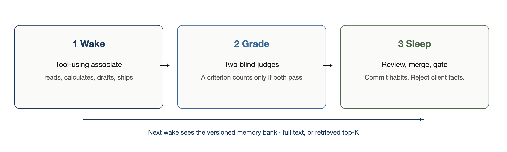
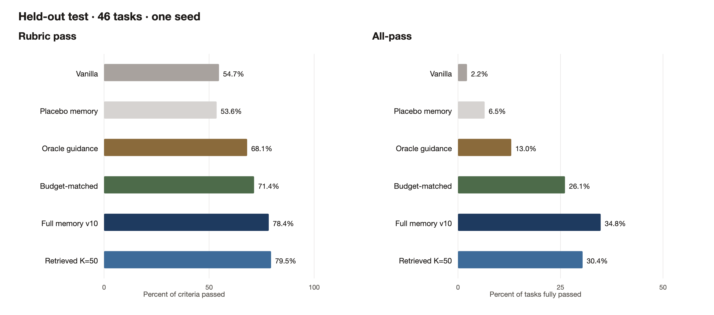
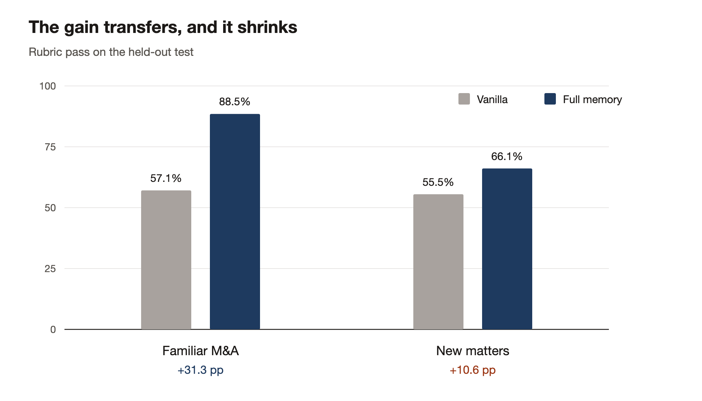
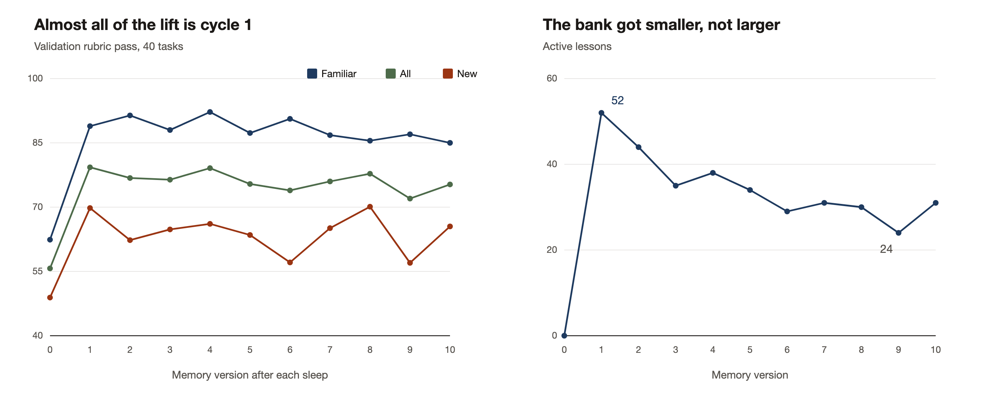
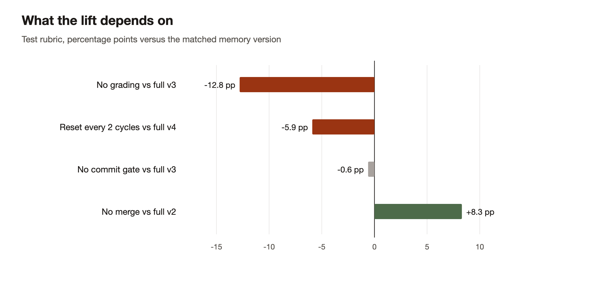
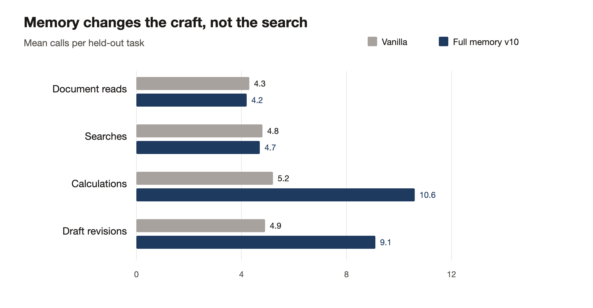
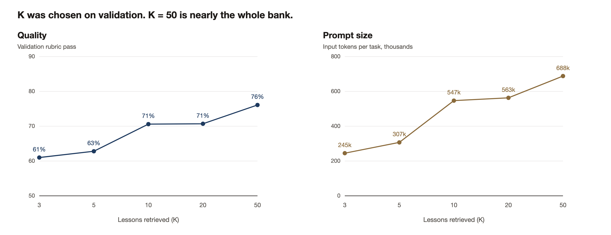

# Wake-sleep for legal agents

Inspired by Niko Grupen’s public article [The Return of Wake-Sleep](https://x.com/nikogrupen/status/2108226990792900876) (8 October 2026). That piece describes a loop for long-horizon legal agents: work a matter online, grade the deliverable against a rubric the agent never sees, distill checklist items and practice notes offline, reject lessons that memorise one client, and inject what remains on the next task. On Harvey’s Legal Agent Benchmark they reported a large all-pass gain, smaller but positive transfer to new matters, and retrieval that roughly halved tokens at the same quality.

This repository is an independent implementation of that protocol. It does not use LAB, Harvey’s models, or Harvey’s tasks. It is our synthetic benchmark, our stack, and the full artifact trail for experiment `ws_2026_001`. A legal agent works online, is graded against rubrics it never sees, and at night the graded traces are distilled into a versioned bank of lessons. The next morning the same agent sees that bank.

The question is whether that loop beats an identical agent with no memory, whether the lessons travel to unseen matters, and whether retrieving only the relevant lessons keeps the quality at a lower token cost.



## Headline (held-out test, 46 tasks)



| Condition | Rubric pass | All-pass | Tokens / task |
|---|---:|---:|---:|
| Vanilla (no memory) | 54.7% | 2.2% | 207k |
| Placebo memory | 53.6% | 6.5% | 277k |
| Oracle (hand-written partner guidance) | 68.1% | 13.0% | 290k |
| Budget-matched full memory | 71.4% | 26.1% | 295k |
| **Full memory (v10)** | **78.4%** | **34.8%** | 634k |
| Retrieved K=50 | 79.5% | 30.4% | 599k |

Full memory versus vanilla is **+23.7 percentage points** on rubric pass (95% CI +15.2 to +32.0, Wilcoxon p < 0.001). All-pass moves from 2.2% to 34.8% (McNemar p = 0.0001). Placebo text of similar bulk does not move the score, so the lift is not “a longer prompt.”

Two limits belong next to that table. The gain on familiar M&A is +31.3 pp; on new practice areas it is +10.6 pp. And on the validation curve, almost all of the movement happens after the first sleep. Later cycles clean the bank more than they compound quality.





Prices in the tables are assumed list prices, for relative comparison only. The short write-up of what we would and would not claim is [`results/ws_2026_001/FINDINGS.md`](results/ws_2026_001/FINDINGS.md). Every generated table is in [`results/ws_2026_001/REPORT_TABLES.md`](results/ws_2026_001/REPORT_TABLES.md).

## What is in the box

```
agents/          tool-using legal agent (read, search, calculate, draft, edit, finish)
wake/            rollout, cached per task, plus the trajectory log
grading/         dual blind judges; a criterion passes only if both pass
sleep/           review → candidate lessons, merge → operations, helpfulness
memory/          lesson store, immutable versions and diffs, commit gate, top-K retrieval
evaluation/      metrics, paired statistics, leakage scanner
data/            synthetic benchmark, 196 tasks (train / validation / test)
experiments/     run_cycle, run_experiment, run_final_eval, ablations
analysis/        generated SVG plots, publication figures, report tables
config/          base.yaml, smoke.yaml, ablation configs
docs/figures/    PNG figures used above
results/ws_2026_001/   the 10-cycle lineage: trajectories, grades, lessons, memory, metrics
results/ws_smoke/      an earlier 2-cycle smoke run
```

`results/ws_2026_001/` is about 1.1 GB. It is the experiment, not a sample.

| Path | What it holds |
|---|---|
| [`trajectories/`](results/ws_2026_001/trajectories) | Full rollouts: tools, drafts, prompts |
| [`grades/`](results/ws_2026_001/grades) | Dual-judge rubric grades |
| [`lessons/`](results/ws_2026_001/lessons) | Sleep candidates and merge proposals |
| [`memory/`](results/ws_2026_001/memory) | Versioned banks, `memory_v0.json` … `memory_v10.json`, plus diffs |
| [`cycles/`](results/ws_2026_001/cycles) | Per-cycle summaries |
| [`plots/`](results/ws_2026_001/plots) | Auto-generated SVG charts (the PNGs above are redrawn from the same tables) |
| [`summary.json`](results/ws_2026_001/summary.json) | Machine-readable totals |
| [`metrics.csv`](results/ws_2026_001/metrics.csv) | Per-task metrics |
| [`task_results.jsonl`](results/ws_2026_001/task_results.jsonl) | Flat per-task outcomes |
| [`metadata/`](results/ws_2026_001/metadata) | Model roles, seed, config snapshot |

Scale, from `summary.json`: **3,904** agent runs, about **2.31B** agent input tokens, **7,316** judge calls, **2,420** sleep reviews, **10** wake–sleep cycles on the main lineage.

## Design

**Dataset.** Synthetic matters. Issue templates plant verifiable facts: a mis-computed cap, a weekend deadline, an undisclosed claim. Rubric answers are computed in Python. A model only writes the document prose around those facts. Each rubric also hides two or three of the firm’s unwritten house standards (bottom line first, pinpoint cites, deadline arithmetic, explicit risk ratings). Those standards never appear in the task instructions. They are the learnable regularity.

**Splits.** Train is 110 M&A tasks. Validation is 40: 20 familiar M&A and 20 new (capital markets and commercial). Test is 46: 20 familiar, 20 new, and 6 negative-control research tasks with no dates or figures. Test is never used to choose K, the budget cap, or anything else. K\* = 50 and the budget-matched cap come from validation.

**Models.** No model grades or gates its own work.

| Role | Model |
|---|---|
| Agent | `deepseek.v3.2` |
| Judges | `zai.glm-5` and `moonshotai.kimi-k2.5` |
| Sleep (review, merge, helpfulness) | `mistral.mistral-large-3-675b-instruct` |
| Commit gate and retrieval scorer | `qwen.qwen3-235b-a22b-2507` |
| Dataset prose | the same Qwen3-235B |
| Embeddings | `sentence-transformers/all-MiniLM-L6-v2` |

Temperature 0, seed 42, at most 50 agent steps. The agent was moved off a smaller quota because ~4k runs would not fit.

**Commit gate.** A deterministic leakage scan (names, amounts, dates, clause numbers, ids, filenames) hard-rejects first. Then a separate verifier returns COMMIT, REJECT, or REVIEW. A lesson that rests on fewer than two independent training tasks does not auto-commit. At memory v10: 138 cumulative rejections, 23 lessons in the review queue, 0 hard leakage hits.

**Aggregation.** Both judges must pass a criterion. Single-judge scores are kept so the one-versus-two-judge comparison can be read in the tables.

## Run it

Python 3.11+. From this directory:

```bash
python -m venv .venv
source .venv/bin/activate
pip install -r requirements.txt
cp .env.example .env   # fill in Azure and Bedrock credentials
```

The client reads `./.env`. If this folder is still inside the monorepo and no local `.env` exists, it falls back to `legal-memory-retrieval/.env`.

```bash
python -m data.build_dataset
python -m experiments.run_experiment --config config/base.yaml --cycles 10
python -m experiments.run_ablations
python -m experiments.run_final_eval
python -m analysis.reports
```

The dataset and the `ws_2026_001` results are already in the tree, so those commands are for a rerun, not for reading the published run. A 2-cycle smoke on a few tasks is `--config config/smoke.yaml`. One cycle on its own:

```bash
python -m experiments.run_cycle --config config/base.yaml --cycle 1
```

Redraw the figures in this README (SVG, plus PNG when Google Chrome is installed):

```bash
python -m analysis.publish_figures
```

Driver `*.out` logs are gitignored. They are local scratch from the original run.

## What the ablations say

Compared on the test set against the main-lineage memory version that ablation actually reached (v2, v3, or v4 — not v10):



- **No grading:** −12.8 pp versus full v3 (p = 0.0004). Without a grader, sleep has little to learn from.
- **No merge:** +8.3 pp versus full v2 (p = 0.018), with about 1,030 lessons and ~2.5× the tokens. Merge buys cost, not accuracy, at this size.
- **Memory reset every two cycles:** −5.9 pp versus full v4 (p = 0.013). Keeping the bank matters.
- **No commit gate:** −0.6 pp, not significant. At this scale the gate’s visible effect is hygiene and a smaller prompt, not a test-score delta. Hard leakage stayed at zero with the gate on.

## Reading the result without over-reading it

1. The tasks are synthetic. House standards are planted in the rubrics on purpose, so a memory that reads grades can learn them. Transfer to real matters is untested.
2. Judges are models. They were not calibrated against attorneys in this run. Agreement across 25,078 criterion pairs is 92.2% (Cohen’s κ = 0.754). That is agreement, not ground truth.
3. Test n = 46, one seed. The new-matters all-pass change is not significant. Negative controls are six tasks.
4. Ablations stopped at 2–4 cycles and are compared with v2/v3/v4, not with v10.
5. K = 50 was best on validation, and v10 only holds 31 active lessons, so “retrieved” is effectively the whole bank. This run does not show a large token saving from retrieval.
6. Budget-matched memory (step and token caps near vanilla) still holds +16.6 pp, so part of the lift is the content of the lessons. Part of the unbudgeted lift is simply more calculation and more draft revisions. Document reads and searches stay flat.





## Citation

If you use the run, cite the repository and the experiment id:

```
Precentis, wake_sleep, experiment ws_2026_001 (2026).
https://github.com/Precentis/wake_sleep
```

The protocol this run follows was set out by Niko Grupen, “The Return of Wake-Sleep,” 8 October 2026: https://x.com/nikogrupen/status/2108226990792900876

No open-source license is attached. The repository is public so the protocol and the artifacts can be read and cited.
